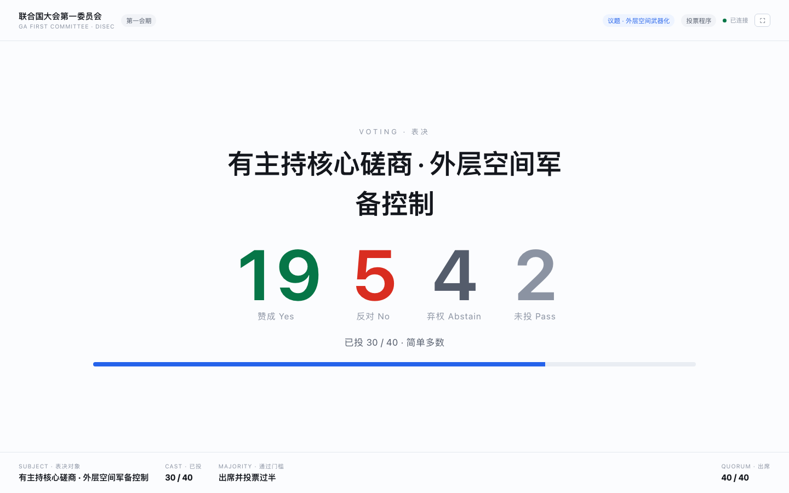
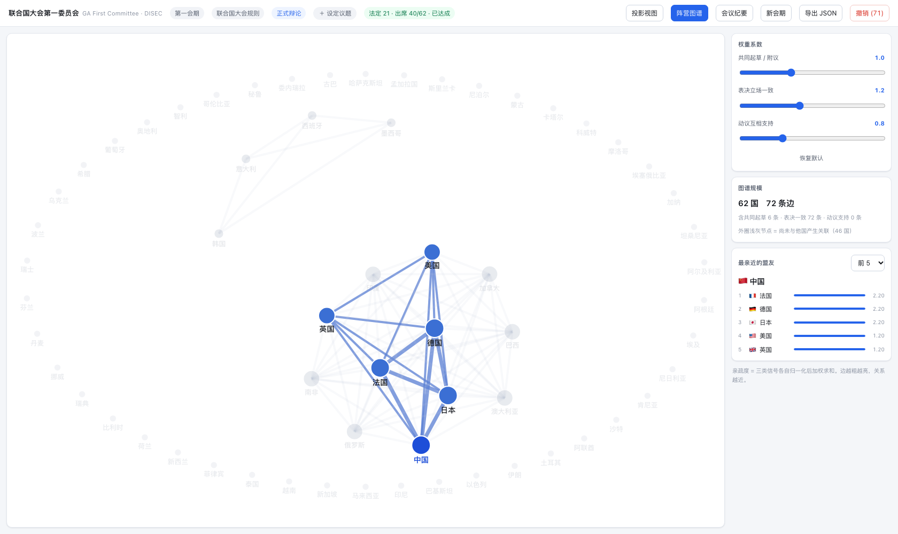
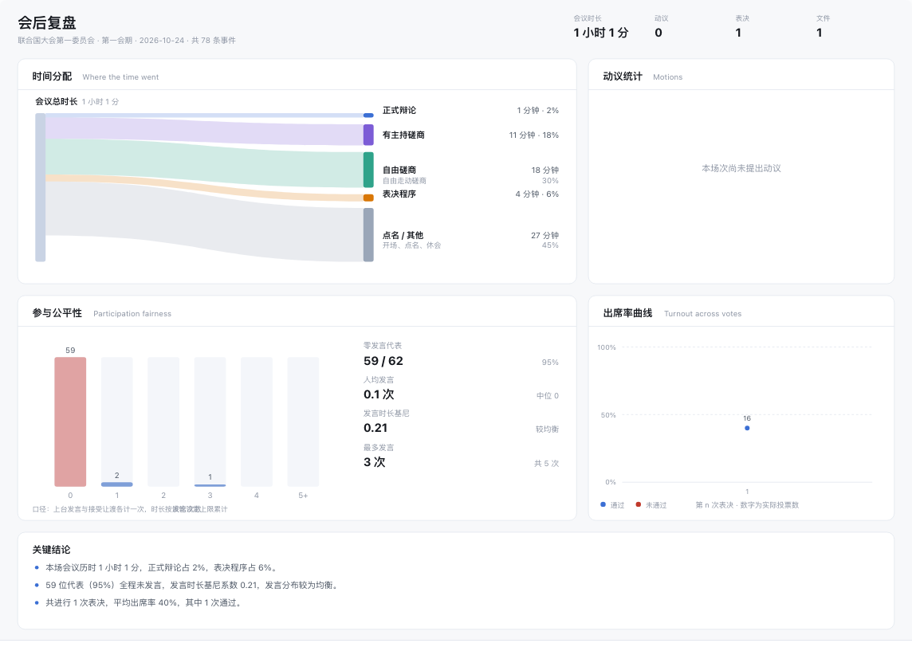

# 主席台 · 线上模联管理工具

给模联主席团用的单机会议管理工具。点名、发言名单、计时、磋商、动议、表决、文件、纪要、复盘全部收在一个界面里，**纯前端、无后端、无登录，数据只存在这台电脑的浏览器里**。



---

## 为什么做这个

一场会下来，主席团要同时盯七八件事：谁出席了、现在法定人数够不够、下一位谁发言、还剩多少秒、刚才那个动议通过了没有、这份决议草案有几票赞成。现场通行做法是 Excel 加秒表加脑子，结果是一到表决就手忙脚乱，会后想复盘"到底谁没说过话"完全无从查起。

这个工具的核心想法很简单：**把每一次操作都记成一条不可变的事件**，界面上看到的一切都是从事件流算出来的。所以撤销是可靠的、纪要是自动的、复盘数据是精确的，而不是靠人回忆。

---

## 功能

### 基础议事流程

| 模块    | 说明                                                |
| ----- | ------------------------------------------------- |
| 点名    | 出席 / 出席并投票 / 缺席 三态；实时算法定人数、简单多数、三分之二、动议门槛（20% 出席） |
| 主发言名单 | 增删改序、追加、去重；一键"下一位发言"并启动计时                         |
| 发言计时  | 默认 90 秒，可启停、重置、加时；剩 30 秒提示音，归零自动通知                |
| 让渡    | 让渡主席 / 代表 / 问题 / 评论；禁止二次让渡                        |
| 磋商    | 有主持（总时长 + 单人限时 + 独立队列）与自由磋商；两套计时器互不干扰             |
| 动议与问题 | 程序性 / 实质性 / 咨询 / 个人特权；提出国、时长、议题；状态流转完整            |
| 表决    | 赞成 / 反对 / 弃权 / 过；简单多数、三分之二、五常否决三种模式，自动裁定          |
| 文件流转  | 工作文件 → 决议草案 → 修正案；起草国与附议国互斥；自动派生表决顺序              |
| 会议纪要  | 从事件流自动生成，一键导出 Markdown / Word                     |
| 会期管理  | 一个委员会可开多个会期；休会即封场，可重开、可永久删除，也能一键重置系统           |

### 会期生命周期

一个委员会下面挂多个会期（第 1 会期、第 2 会期…），名册共享、事件流各自独立。主席台右上角的两个按钮负责进出：

- **休会** —— 本场次标记为「已结束」并写入 `endedAt`，三个计时器（主发言 / 有主持单人 / 有主持总时长）一起暂停，讲台控件锁死，大屏切到「休会 / ADJOURNED」一屏。不是删除。
- **会期列表** —— 回到选会期页面，已结束的场次带灰色「已结束」标记和时间戳，点一下就能重新打开，状态原样恢复。数据全程已落库，随时可以关掉浏览器。

三种"结束"的区别，别搞混：

| 动作 | 记录 | 能否恢复 | 什么时候用 |
| --- | --- | --- | --- |
| **休会** | 保留 | 能，随时重开 | 这场开完了，以后还想翻记录 |
| **删除会期** | 抹掉 | 不能，撤销也回不来 | 测试场、开错了、不想留档 |
| **重置系统** | 全清 | 不能 | 换一场完全不同的会，回到出厂状态 |

删除会期时会先数一遍要扔掉多少条记录再让你确认。重置系统要连点两次确认，清的是 IndexedDB（委员会 + 名册 + 全部会期 + 事件流）**和** localStorage（话术库、阵营权重、雷达排序），只按 `mun-chair/` 前缀删，不碰同域下别人的键；同时会给大屏发一条 `reset`，让它回到「等待主席台连接」，而不是继续挂着上一场的最后一帧。

休会本身也是一条事件，所以点「撤销」就能退回去继续开会。注意：撤销恢复的是"计时器一直在跑"的状态，如果休会已经过去几分钟，回来时倒计时会按真实流逝直接归零——这是「计时器只存起点、不存剩余秒数」的必然结果，不是 bug。

### 四个差异化功能

**F1 阵营图谱** —— 力导向图，边的权重来自三类信号加权：共同起草同一份文件、表决立场一致、动议互相支持。每类信号先按本场最大值归一化再加权，避免"共同起草 8 次"压死"投票一致 2 次"。点任一国家高亮其最亲近的 N 个盟友，三个权重系数可实时调整。



> 布局做了特殊处理：真实会场的数据往往是"少数几个国家有边、其余全是孤点"，把两类节点丢进同一套力学里，孤点会被斥力顶到画布边缘挤成一圈。所以按 degree 拆成两区——有边的走力导向占中间，孤点沿椭圆环按弧长等距排开，视觉上明确"尚未入网"。

**F2 主席提词器** —— 21 个状态的脚本机，根据当前会议阶段、计时状态、表决进度自动推送该说的话，中英双语。词条可编辑并存在 localStorage，新版本新增的状态会自动合并进来。

**F3 沉默代表雷达** —— 常驻侧栏，按发言次数升序排列，零发言代表红色置顶，过度参与标黄。可按次数 / 时长 / 距上次发言排序，一键把沉默国家加进主发言名单。所有数据从事件流推导，撤销后自动一致。

**F4 会后复盘** —— 桑基图看时间都花在哪了（正式辩论 / 有主持磋商 / 自由磋商 / 表决 / 其他），动议统计（总数、通过率、平均裁定耗时），参与公平性（零发言人数、发言次数直方图、时长基尼系数），出席率曲线（每次表决一个点）。



> 整份报告是一张 1240×880 的 SVG，界面显示和导出用的是同一份，所见即所得。PNG 走 canvas，PDF 是手写单页文件把 JPEG 用 `DCTDecode` 直接嵌入，不引任何图表库或 PDF 库。

---

## 快速开始

```bash
npm install
npm run dev
```

打开 **<http://127.0.0.1:5273>** （端口写在 `vite.config.ts` 里）。

首次进入是设置页：填委员会名称、选议事规则集（GA / UNSC）、定代表席位数。内置 157 席候选池，可以按预设快速选（安理会 15 / 小委会 20 / 中委会 40 / 大会 62 / 全池），也可以直接填任意数字，或者自己添加观察员、非国家实体。

### 双屏：主席台 + 投影

会场通常需要一块大屏给代表看。点顶栏的「投影视图」会打开一个独立窗口（地址是 `?view=projection`），把它拖到投影仪那块屏上即可。

投影窗口是**只读镜像**，不连数据库、不发事件、不出声。它会根据当前状态自动切四种画面：表决（大号计票）、结果（通过 / 未通过，停留 15 秒）、磋商（当前发言人 + 单人限时）、正式发言（发言人 + 倒计时）。右上角有连接状态指示，主席台窗口关掉超过 8 秒会变红提示「已断开」。

| 磋商 | 结果 |
| -- | -- |
| 磋商 | 结果 |

### 构建

```bash
npm run build      # 先 tsc --noEmit 再 vite build，产物在 dist/
npm run preview
```

---

## 架构

### 事件溯源

整个应用是一个 append-only 的事件流：

```
操作 → SessionEvent → IndexedDB
                ↓
            reduce() 折叠
                ↓
         SessionState（界面只读这个）
```

- **撤销 = 截断尾部 + 重放**，不是"反向操作"。所以任何操作都能可靠回退，不会出现"改了一半"的中间态。
- **纪要和复盘不需要额外存储**，它们是把同一条事件流编译成不同视图。
- **改规则集不会篡改历史**：动议在提出时就把类型名和表决门槛快照进事件里。

事件分片存在 IndexedDB，复合键 `[sessionId, seq]`，所以一个委员会下的多个会期互不干扰。

### 两条正交的状态机

| 状态机            | 回答的问题  | 驱动谁       |
| -------------- | ------ | --------- |
| `MeetingPhase` | 现在该干什么 | 主席提词器（F2） |
| `TimerStatus`  | 还剩几秒   | 投影视图      |

两者互不依赖，所以"自由磋商中但计时已暂停"这种状态能自然表达。

### 计时器只存意图，不存读数

计时器状态里只有 `remainingMs` 和 `startedAt`，**绝不逐秒写事件**。任何时刻的剩余时间由纯函数推导：

```ts
remainingNow(t, now) = t.status === 'running'
  ? max(0, t.remainingMs - (now - t.startedAt))
  : t.remainingMs
```

好处：事件量极小（一场会几百条而不是几万条），投影窗口用本地时钟就能算出精确读数，主窗口卡顿也不会让大屏漂移。

### 三套计时器共用一个事件词汇

正式发言、磋商单人、磋商总时长是三个独立计时器，但事件类型只有一套。靠 `TimerTarget` 寻址：

```ts
'timer/start': { durationSec, speakerId, target?: 'floor' | 'caucus_speaker' | 'caucus_total' }
```

新增第四套计时器不需要加事件类型，只要加一个 target 值。

### 目录结构

```
src/
  domain/     纯函数，不依赖 React，可单测
    types.ts      所有类型定义（唯一真源）
    events.ts     事件负载表 —— 新增操作的唯一扩展点
    reducer.ts    事件折叠
    derive.ts     法定人数 / 表决门槛
    voting.ts     计票与裁定口径
    timer.ts      计时器推导
    minutes.ts    纪要（事件流 → 中间表示 → 两种渲染）
    postmortem.ts 复盘指标
    bloc.ts       阵营图谱（加权 + 布局）
    script.ts     提词器状态机
  store/      zustand + IndexedDB + BroadcastChannel
  ui/         组件，全部无 UI 库
  lib/        导出（SVG → PNG → PDF）
```

**新增一种操作的完整成本**：`events.ts` 加一行负载类型 + `reducer.ts` 加一个 case。存储、广播、撤销、纪要、复盘自动兼容。

---

## 数据与隐私

- 数据存在浏览器 IndexedDB（库名 `mun-chair`），分 `kv`（委员会 / 会期）和 `events`（事件流）两个 store。
- **没有后端，没有账号，不上传任何东西**。换电脑或清缓存数据就没了，所以顶栏提供「导出 JSON」做备份。
- 选会期页面有「清空全部数据」，会删掉本机所有会议记录，不可恢复。

---

## 表决口径

写死在 `domain/voting.ts`，改之前请确认符合你所用的议事规则：

- **分母 = 赞成 + 反对**（present and voting）。弃权和「过」不计入分母。
- **简单多数** = 赞成 > 反对
- **三分之二** = 赞成 ≥ ⌈2/3 × 分母⌉
- **五常否决** = 先过简单多数，然后任一 P5 投反对即否决。**P5 弃权不算否决。**

---

## 已知限制

- **单委员会**。一个浏览器只能有一份数据，不支持同时管两个委员会。
- **不能多人协作**。投影窗口靠 `BroadcastChannel` 同步，必须和主席台在同一个浏览器里。
- **Word 导出是 HTML 变体**（`.doc` + `application/msword`），Word / WPS 能正常打开，但不是真正的 OOXML `.docx`。
- **时间统计会封顶**：单段超过 30 分钟且期间没有任何操作记录，按 30 分钟计——那多半是茶歇或忘关计时。连续 60 分钟但有几十条发言记录的辩论不受影响。
- **名册在开过会期后只能加人、不能删人**。事件按 `delegationId` 关联，删了会留下悬空引用。
- 没有自动化测试，验证方式是端到端脚本驱动真实浏览器（`samples/` 里的截图就是验证过程留下的）。

---

## 技术栈

React 18 · TypeScript 5.6 · Vite 5 · zustand 4

没有 UI 组件库，没有图表库，没有 PDF 库。图表、桑基图、力导向布局、PDF 生成全部手写，所以整个包 gzip 后约 90KB。
